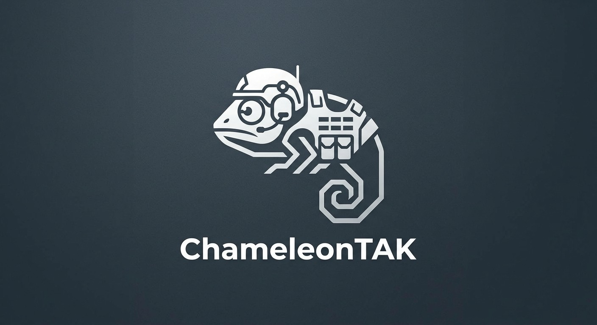

<p align="center"></p>

# ChameleonTAK

Samokonfigurujący się serwer TAK (ATAK, iTAK, WinTAK, TAKAware) dla Raspberry Pi.
Wgrywasz obraz na kartę SD, uruchamiasz Raspberry, otwierasz przeglądarkę i wpisujesz nazwę serwera.
Resztę (urząd certyfikacji, certyfikaty, usługi, zapora, sieć) serwer robi sam.

## Co potrafi

- **Strumień CoT** (TLS 8089, opcjonalnie TCP 8087): pozycje, czat, wiadomości prywatne, markery, grupy/kanały.
- **Automatyczne certyfikaty**:
  - jednorazowy link / kod QR dla każdego urządzenia; telefon pobiera gotową paczkę z certyfikatem;
  - enrollment zgodny z TAK Server (port 8446, CSR podpisywany przez serwer);
  - unieważnianie certyfikatów jednym kliknięciem.
- **Profile urządzeń**: paczki danych generowane osobno dla ATAK, iTAK, WinTAK i TAKAware (znak wywoławczy, zespół, rola).
- **Marti API** (8443): udostępnianie plików i paczek danych, misje (Data Sync) z powiadomieniami, grupy.
- **Panel WWW**:
  - kreator pierwszego uruchomienia, mapa na żywo, użytkownicy i urządzenia;
  - masowe dodawanie użytkowników z drukowanymi kartami QR;
  - czat, pliki, misje, certyfikaty, kopie zapasowe.
- **Raspberry Pi**: gotowy obraz, hotspot konfiguracyjny bez kabla (`ChameleonTAK-Setup`), tryb „hotspot w terenie” bez internetu.

## Szybki start

1. Pobierz `chameleontak-<wersja>-arm64.img.xz` z wydania i wgraj Raspberry Pi Imagerem (szczegóły: [docs/IMAGE.md](docs/IMAGE.md)).
2. Uruchom Raspberry:
   - z kablem LAN otwórz `http://chameleontak.local`;
   - bez kabla połącz się z Wi-Fi `ChameleonTAK-Setup` (hasło `chameleontak`); kreator otworzy się sam.
3. W kreatorze podaj nazwę serwera (podpowiadane jest wykryte IP) i hasło administratora.
4. W panelu dodaj użytkownika z urządzeniem. Użytkownik skanuje kod QR aparatem telefonu, pobiera konfigurację i otwiera ją w ATAK/iTAK.

Instalacja na istniejącym Debianie / Raspberry Pi OS:

```bash
curl -fsSL https://github.com/OWNER/chameleontak/releases/latest/download/install.sh | sudo bash
```

## Rozwój

```bash
cd web && npm ci && npm run build && cd ..
go test ./...
go run ./cmd/chameleontak serve --data ./devdata --http :8080 --https :8444
```

- Architektura i kontrakt API: [docs/ARCHITECTURE.md](docs/ARCHITECTURE.md).
- Notatki o protokole TAK: [docs/research/](docs/research/).
